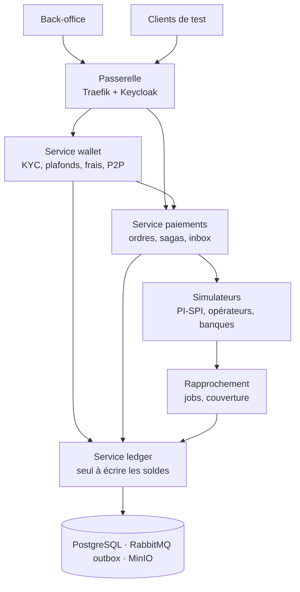

# SenWallet

> Simulateur de portefeuille numérique (digital wallet) pour la zone UEMOA, construit sur un ledger en partie double, en XOF.

SenWallet est une **étude de cas** : un projet d'apprentissage construit en public pour pratiquer, de bout en bout, la conception d'un wallet digital — ledger comptable, soldes, concurrence, rails de paiement, rapprochement et contraintes réglementaires BCEAO.

> **Avertissement** — SenWallet SA est un émetteur de monnaie électronique **fictif**. Ce projet n'est pas un produit financier, ne détient pas de fonds réels et n'est relié à aucun rail de paiement réel : PI-SPI, les opérateurs mobile money et les banques sont **simulés**.

---

## Sommaire

- [SenWallet](#senwallet)
  - [Sommaire](#sommaire)
  - [Pourquoi ce projet](#pourquoi-ce-projet)
  - [Fonctionnalités](#fonctionnalités)
  - [Concepts clés](#concepts-clés)
    - [Le ledger est la seule source de vérité](#le-ledger-est-la-seule-source-de-vérité)
    - [Trois soldes par wallet](#trois-soldes-par-wallet)
    - [Exemple d'écriture (P2P avec frais)](#exemple-décriture-p2p-avec-frais)
    - [Règles BCEAO appliquées (scénario fictif)](#règles-bceao-appliquées-scénario-fictif)
  - [Architecture](#architecture)
    - [Bounded contexts (DDD)](#bounded-contexts-ddd)
  - [Stack technique](#stack-technique)
  - [Structure du monorepo](#structure-du-monorepo)
  - [Démarrage rapide](#démarrage-rapide)
    - [Prérequis](#prérequis)
    - [Lancer l'environnement local](#lancer-lenvironnement-local)
    - [Services locaux](#services-locaux)
    - [Exemple : un transfert P2P](#exemple--un-transfert-p2p)
  - [Simulateurs et injection de pannes](#simulateurs-et-injection-de-pannes)
  - [Tests](#tests)
  - [Feuille de route](#feuille-de-route)
  - [Conventions de travail](#conventions-de-travail)
  - [Documentation](#documentation)
  - [Auteur et licence](#auteur-et-licence)

---

## Pourquoi ce projet

Un wallet ressemble à un solde et un bouton « Envoyer ». En dessous, tout repose sur la rigueur du ledger : que compte un top-up encore en attente ? Que faire d'un cash-out expiré chez l'opérateur mais peut-être versé ? Que se passe-t-il quand 100 transferts partent au même instant du même compte ?

SenWallet répond à ces questions par du code et par des tests qui les prouvent. L'architecture du ledger s'inspire de l'ebook de Modern Treasury [*Building a Digital Wallet: From Ledger to Launch*](https://www.moderntreasury.com/ebooks/building-a-digital-wallet-from-ledger-to-launch), adaptée au contexte UEMOA.

## Fonctionnalités

| Domaine       | MVP                                                                          |
| ------------- | ---------------------------------------------------------------------------- |
| Inscription   | Téléphone + OTP, KYC simulé par niveau (N1, N2, marchand)                    |
| Alimentation  | Virement PI-SPI entrant, top-up mobile money (Wave, Orange Money simulés)    |
| Transferts    | P2P par téléphone, alias ou QR, frais de 1 %                                 |
| Retraits      | Cash-out mobile money et PI-SPI sortant, avec suivi de l'ordre               |
| Paiements     | Paiement marchand par QR                                                     |
| Soldes        | Comptable, en attente, disponible ; solde à date                             |
| Conformité    | Plafonds BCEAO, règles LBC/FT simples, journal d'audit                       |
| Rapprochement | Banques, PI-SPI, opérateurs, couverture du cantonnement, détection de dérive |
| Back-office   | Recherche, gels, ajustements avec double validation (maker-checker)          |

## Concepts clés

### Le ledger est la seule source de vérité

- Chaque mouvement est une **transaction équilibrée** : Σ débits = Σ crédits, au moins deux écritures.
- Les écritures sont **immuables** ; une correction est une transaction inverse.
- Les montants sont des **entiers en XOF** (exposant 0) : `5 000 XOF` est stocké `5000`. Aucun flottant.
- Seul le service ledger écrit les soldes, dans la même transaction de base de données que les écritures.

### Trois soldes par wallet

| Solde                        | Inclut                                                | Usage                              |
| ---------------------------- | ----------------------------------------------------- | ---------------------------------- |
| **Comptable** (`posted`)     | Écritures réglées                                     | Rapprochement, relevés             |
| **En attente** (`pending`)   | Réglé + en cours                                      | Montrer l'argent en mouvement      |
| **Disponible** (`available`) | Réglé − sorties bloquées ; entrées en attente exclues | Ce que l'utilisateur peut dépenser |

Exemple : Adama a 49 500 XOF réglés et un top-up Wave de 20 000 en attente → comptable 49 500, en attente 69 500, **disponible 49 500**.

### Exemple d'écriture (P2P avec frais)

| Compte              |  Débit | Crédit |
| ------------------- | -----: | -----: |
| Wallet Adama        | 50 500 |        |
| Wallet Binta        |        | 50 000 |
| Revenus — frais P2P |        |    500 |

### Règles BCEAO appliquées (scénario fictif)

- Avoirs plafonnés à **4 000 000 XOF** par client et par émetteur ; rechargements plafonnés à **15 000 000 XOF** par mois (Instruction n° 020, en vigueur le 2 novembre 2026).
- Contrepartie de la monnaie électronique couverte à **100 %** par le cantonnement, dont **≥ 65 %** en dépôts à vue.
- Aucun crédit, aucun intérêt sur les fonds détenus.

Les plafonds sont de la **configuration datée**, jamais des constantes dans le code.

## Architecture



Principes :

1. **Ledger isolé** : service et base dédiés.
2. **Idempotence de bout en bout** : `Idempotency-Key` à l'API, `external_id` déterministe au ledger, inbox dédoublonnée pour les callbacks.
3. **Outbox transactionnelle** : livraison « au moins une fois », consommateurs idempotents.
4. **Sagas orchestrées** : chaque mouvement externe est une machine à états explicite. Un délai dépassé mène à l'état « inconnu », jamais à un échec automatique.
5. **Pannes comme fonctionnalité** : les simulateurs exposent une API d'injection de pannes.

### Bounded contexts (DDD)

| Contexte         | Sous-domaine | Agrégats principaux                                            |
| ---------------- | ------------ | -------------------------------------------------------------- |
| `ledger`         | Cœur         | `LedgerAccount`, `LedgerTransaction`, `AccountCategory`        |
| `wallet`         | Cœur         | `Customer`, `Wallet`, `Transfer`, `FeeSchedule`, `LimitPolicy` |
| `payments`       | Support      | `PaymentOrder`, `CallbackInboxEntry`                           |
| `reconciliation` | Support      | `ReconciliationRun`, `Match`, `Break`, `CoverageReport`        |

Chaque contexte est découpé en quatre modules Gradle — `domain` (Java pur), `application`, `infrastructure`, `boot` — et les règles de dépendance sont vérifiées par ArchUnit.

## Stack technique

| Besoin               | Choix                                                       |
| -------------------- | ----------------------------------------------------------- |
| Langage              | Java 25 (LTS), threads virtuels                             |
| Framework            | Spring Boot 4.x, Spring Web MVC                             |
| Build                | Gradle (Kotlin DSL), version catalog, plugins de convention |
| Base de données      | PostgreSQL 16, une base par service, migrations Flyway      |
| Persistance ledger   | `JdbcClient` (SQL explicite, sans JPA)                      |
| Messagerie           | RabbitMQ (Spring AMQP)                                      |
| Sécurité             | Keycloak, Spring Security OAuth2 Resource Server            |
| Passerelle           | Traefik                                                     |
| Résilience           | Resilience4j                                                |
| Stockage de fichiers | MinIO                                                       |
| Observabilité        | Micrometer, OpenTelemetry, Prometheus, Grafana, Loki, Tempo |
| Tests                | JUnit 5, jqwik, Testcontainers, ArchUnit, WireMock, k6      |

## Structure du monorepo

```text
senwallet/
├── settings.gradle.kts
├── gradle/libs.versions.toml      # versions centralisées
├── build-logic/                   # plugins de convention
├── platform/
│   ├── shared-kernel/             # Money XOF, identifiants, DomainEvent
│   ├── event-contracts/           # événements publiés (records + JSON Schema)
│   └── test-support/              # Testcontainers, fixtures
├── contexts/
│   ├── ledger/          {domain, application, infrastructure, boot}
│   ├── wallet/          {domain, application, infrastructure, boot}
│   ├── payments/        {domain, application, infrastructure, boot}
│   └── reconciliation/  {domain, application, infrastructure, boot}
├── simulators/          {pispi, mno, bank}
├── backoffice/
├── contracts/openapi/             # contrats HTTP entre contextes
├── tests/               {property, integration, load}
├── docs/milestones/               # notes de fin de jalon
└── deploy/docker-compose.yml
```

## Démarrage rapide

> Les commandes ci-dessous deviennent disponibles au fil des jalons : le socle (M0) permet le build et la base, les services s'ajoutent ensuite.

### Prérequis

- JDK 25
- Docker et Docker Compose
- Git

### Lancer l'environnement local

```bash
git clone https://github.com/saifcores/SenWallet.git
cd SenWallet

# Compiler et lancer tous les tests
./gradlew build

# Démarrer l'infrastructure et les services
docker compose -f deploy/docker-compose.yml up -d
```

### Services locaux

| Conteneur                                                 | Rôle                                          | Port      |
| --------------------------------------------------------- | --------------------------------------------- | --------- |
| `gateway`                                                 | Traefik : TLS, routage, quotas                | 443       |
| `keycloak`                                                | Authentification OIDC                         | 8080      |
| `wallet`                                                  | Service wallet                                | 8001      |
| `ledger`                                                  | Service ledger (non exposé par la passerelle) | 8002      |
| `payments`                                                | Service paiements                             | 8003      |
| `recon`                                                   | Rapprochement                                 | 8004      |
| `backoffice`                                              | Interface web interne                         | 3000      |
| `postgres`                                                | PostgreSQL 16                                 | 5432      |
| `rabbitmq`                                                | Broker de messages                            | 5672      |
| `minio`                                                   | Relevés, fichiers, rapports                   | 9000      |
| `sim-pispi`, `mno-wave`, `mno-orange`, `bank-a`, `bank-b` | Simulateurs                                   | 9101–9105 |

### Exemple : un transfert P2P

```bash
curl -X POST https://localhost/api/transfers \
  -H "Authorization: Bearer $TOKEN" \
  -H "Idempotency-Key: 3f1c9a52-7d0e-4b8a-9f21-6c2d5e8a1b44" \
  -H "Content-Type: application/json" \
  -d '{
        "from_wallet_id": "<wallet_adama>",
        "to_phone": "+221770000000",
        "amount": 50000,
        "currency": "XOF"
      }'
```

Rejouer la même requête avec la même `Idempotency-Key` renvoie la même réponse sans créer de second transfert.

## Simulateurs et injection de pannes

Chaque simulateur expose une API métier (vue par la plateforme) et une API de contrôle (vue par les tests).

```bash
# Le prochain cash-out Orange Money expire, puis réussit 2 minutes plus tard
curl -X POST http://localhost:9103/control/faults \
  -H "Content-Type: application/json" \
  -d '{
        "operation": "disbursements",
        "mode": "timeout_then_success",
        "probability": 1.0,
        "delay_ms": 120000,
        "count": 1
      }'
```

Modes disponibles : `reject`, `latency`, `timeout_then_success`, `timeout_then_failure`, `duplicate_callback`, `out_of_order_callback`, `float_exhausted`, `missing_statement_line`, `wrong_amount`.

## Tests

```bash
./gradlew test               # unitaires + propriétés (jqwik) + ArchUnit
./gradlew integrationTest    # Testcontainers : PostgreSQL, RabbitMQ, simulateurs
k6 run tests/load/p2p.js     # charge (à partir du jalon M10)
```

Tests emblématiques :

| Test                                               | Ce qu'il prouve                          |
| -------------------------------------------------- | ---------------------------------------- |
| Propriété sur 10 000 transactions aléatoires       | Σ débits = Σ crédits, toujours           |
| 1 000 rejeux du même transfert                     | Une seule transaction créée              |
| 100 débits concurrents de 20 000 sur 1 000 000 XOF | Exactement 50 succès, aucun découvert    |
| Crédit au-delà du plafond de 4 000 000 XOF         | Rejet 422, rien d'écrit                  |
| Cash-out expiré puis réussi                        | Posté une seule fois                     |
| Ligne manquante dans un relevé bancaire            | Écart détecté, ligne en compte d'attente |

## Feuille de route

Le projet avance par jalons ; un jalon n'est terminé que lorsque ses tests passent en CI.

| Jalon | Contenu                                                  | État    |
| ----- | -------------------------------------------------------- | ------- |
| M0    | Socle du monorepo : Gradle, CI, Docker Compose, ArchUnit | À faire |
| M1    | Domaine du ledger en Java pur, tests de propriété        | À faire |
| M2    | Persistance PostgreSQL, algorithme de posting, API REST  | À faire |
| M3    | Outbox, RabbitMQ, contrats d'événements                  | À faire |
| M4    | Contexte wallet : KYC, plafonds, frais, P2P              | À faire |
| M5    | Passerelle Traefik, Keycloak, jetons de service          | À faire |
| M6    | Simulateurs PI-SPI, opérateurs, banques, pannes          | À faire |
| M7    | Contexte paiements : sagas, inbox, enquêtes de statut    | À faire |
| M8    | Rapprochement, couverture, dérive                        | À faire |
| M9    | Back-office, double validation, AML                      | À faire |
| M10   | Observabilité, charge, reprise après sinistre            | À faire |

## Conventions de travail

- **Branches** : une branche par jalon, ex. `milestone/m2-ledger-persistence`, fusionnée par pull request.
- **Tags** : un tag Git par jalon terminé (`m0` … `m10`).
- **CI** : build → tests unitaires et propriétés → ArchUnit → tests d'intégration → (à partir de M10) charge courte.
- **Migrations** : Flyway, versionnées, jamais modifiées après fusion.
- **Décisions** : chaque choix structurant est consigné dans un ADR.
- **Fin de jalon** : une note dans `docs/milestones/Mx.md` — ce qui a été construit, appris, et ce qui reste.

## Documentation

- Cahier des charges de l'étude de cas (CDC)
- Dossier d'architecture
- Plan de réalisation par jalons
- Source d'inspiration : [Modern Treasury — Building a Digital Wallet: From Ledger to Launch](https://www.moderntreasury.com/ebooks/building-a-digital-wallet-from-ledger-to-launch)
- Réglementation : [BCEAO — Instruction n° 020 modifiant l'Instruction n° 008-05-2015](https://www.bceao.int/fr/reglementations/instruction-ndeg-020-portant-modification-de-linstruction-ndeg-008-05-2015-du-21) · [PI-SPI](https://www.bceao.int/fr/content/lancement-officiel-de-la-plateforme-interoperable-du-systeme-de-paiement-instantane-pi-spi)

## Auteur et licence

Projet conçu et développé par **Saifcore - Saïfoulaye Diallo** (Dakar, Sénégal).

Licence : [MIT](LICENSE).
